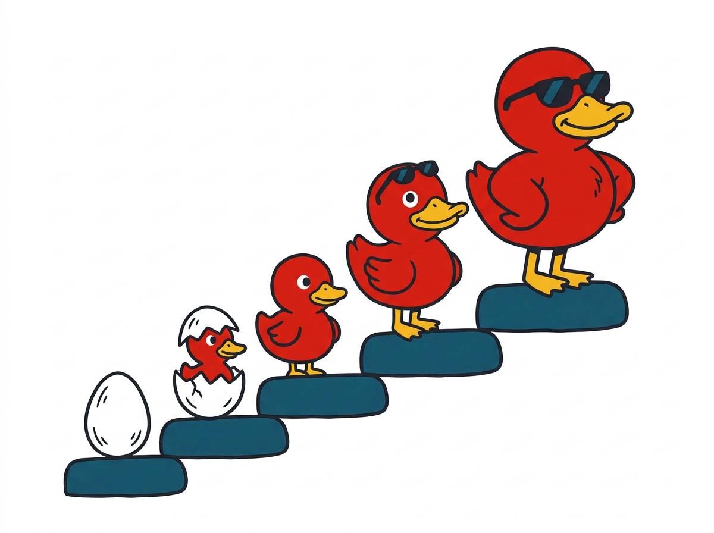

  

<h1 align="center">Duck Norris Doesn't Phone Home</h1>

<em>WeAreDevelopers Conference India workshop: build a zero-cost AI agent in your browser. 120 minutes including Q&amp;A.</em>

  <strong>Nishant Kumar Thakur</strong> &nbsp;·&nbsp; <strong>Aishwarya Mathuria</strong>

## Getting started

New here? Start with the [pre-workshop setup guide](pre-workshop-guide.md) to install VS Code and Live Server and to download this folder. Prefer `git clone` (the repo is about 1.5 GB because the AI model is inside it), so do it on good wifi. After that the workshop runs with **no internet**: [`exercise/setup-check.html`](exercise/setup-check.html) checks the laptop (WebGPU, GPU, model files).

## Runs offline

Nothing is fetched from the internet (except the Wikipedia and weather tools in chapter 7):

- `models/gemma-2-2b-it-q4f16_1-MLC/`: the Gemma 2 2B weights, tokenizer and WebGPU library (WASM), copied from Hugging Face and the MLC binary-libs repo. `params_shard_0.bin` is 295 MB, over GitHub's 100 MB file limit, so it is stored as six `.partN` files that the loader joins once in the browser.
- `vendor/web-llm.js`: WebLLM 0.2.88, the same file the CDN served. `vendor/web-llm-local.js` wraps it: same API, but it points the model at `models/`. Exercise files import `../vendor/web-llm-local.js` instead of `https://esm.run/@mlc-ai/web-llm@0.2.88`.
- `vendor/`: also the fonts, `marked`, `DOMPurify` and Phaser.
- A page deployed on its own (chapter 8, GitHub Pages) has no `vendor/` or `models/` next to it, so `5-face.html`, `6-yours.html` and `7-hands.html` fall back to the CDN and Hugging Face.

## Licences and credits

- **Gemma model** (`models/`): Gemma is provided under and subject to the [Gemma Terms of Use](https://ai.google.dev/gemma/terms). A copy and the required notice are in `models/gemma-2-2b-it-q4f16_1-MLC/` (`NOTICE`, `GEMMA_TERMS_OF_USE.md`). Anyone using the files agrees to the terms and to the [Prohibited Use Policy](https://ai.google.dev/gemma/prohibited_use_policy). The weights were converted to the MLC format by [MLC AI](https://huggingface.co/mlc-ai/gemma-2-2b-it-q4f16_1-MLC) and split into pieces here; the notice says so.
- **Libraries in `vendor/`:** [WebLLM](https://github.com/mlc-ai/web-llm) (Apache-2.0), [reveal.js](https://revealjs.com) (MIT), [marked](https://github.com/markedjs/marked) (MIT), [DOMPurify](https://github.com/cure53/DOMPurify) (Apache-2.0 / MPL-2.0), [Phaser](https://phaser.io) (MIT), and the fonts Inter, JetBrains Mono and Geist (SIL Open Font Licence).
- **Duck Norris** is the mascot of [WeAreDevelopers](https://www.wearedevelopers.com/conference-india). The illustrations here are original artwork inspired by it, not official WeAreDevelopers assets.

To change the model, replace the folder under `models/`, update the id and file names at the top of `vendor/web-llm-local.js`, and split any shard over 50 MB.

## Open the workshop

Serve this folder with Live Server (or `npx serve`): the model only loads from `http://localhost`, not from a `file://` page. Then open:

- [`index.html`](index.html): the landing page. Links to the slides, the setup steps and every exercise file. Send attendees here.
- [`slides.html`](slides.html): the deck.
- [`exercise/0-egg.html`](exercise/0-egg.html): where attendees start.
- [`showcase/`](showcase/): six finished apps built with the same trick as chapter 7 (adventure, quiz-tutor, budget, flashcards, escape-room, npc-civilization). Homework ideas, linked from the landing page.

## Exercise files

Each file is where you should be at the end of that chapter. Behind? Open the previous number and carry on.

| File | Chapter | You type |
|---|---|---|
| `0-egg.html` | start | - |
| `1-brain.html` | 1 · load the model | import + `CreateMLCEngine` |
| `2-voice.html` | 2 · chat + streaming | `ask()` |
| `3-character.html` | 3 · system prompt | `system` message |
| `4-memory.html` | 4 · chat history | `chatHistory` |
| `5-face.html` | 5 · chat UI | nothing: read-along. This is the file you customise in chapter 6 |
| `6-yours.html` | 6 · make it yours | name, system prompt, welcome message, colour (a finished example: FitCoach) |
| `7-hands.html` | 7 · tools | nothing: demo and read-along |

`setup-check.html` checks WebGPU, the GPU, free storage and that every model file is present, without loading the model. `style.css` belongs to files 5, 6 and 7.

### What `nest.js` does

It draws the duck, the feather strip and the next quest on every exercise file, and prints WebGPU problems in red.

- **Files 0 to 4:** it awards feathers by reading the request your code sends to the model (`stream: true`, a leading system message, an assistant message in the history).
- **Files 5 to 7:** it is a slim bar above the chat. The face feather lights when the chat appears, and the hands feather when the model first calls a tool.
- **Pills:** every page shows example prompts for the chapter you are on, for instance long-story prompts while you add streaming, and "My name is Duck Norris." then "What's my name?" while you add memory. Clicking a pill fills the chat box, then you press Send.

## Versions

The libraries are pinned (WebLLM 0.2.88, marked 15.0.12, DOMPurify 3.4.17) so a new release can't break the room. To upgrade, change the version in every file (`grep -rn "esm.run" .`) and re-run `./check.sh`.

## Checks

`./check.sh` runs every exercise file against a fake model in headless Chrome and checks the feathers. It does not load the real model.
