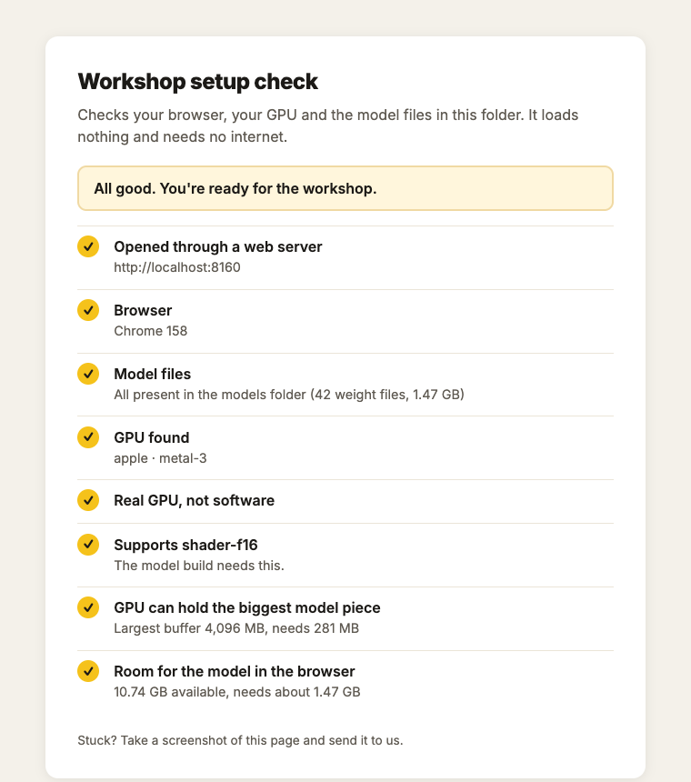

# Pre-workshop setup guide

Do this before WeAreDevelopers Conference India. It takes about 15 minutes, most of it one 1.5 GB download (the AI model is inside the workshop folder), so use good wifi. After that you need no internet.

## What you'll need

1. A laptop with **Google Chrome** installed (latest version)
2. A code editor. We recommend **VS Code** (https://code.visualstudio.com)
3. The workshop folder, with the AI model inside it (Step 3)
4. About **5 GB of free disk space** (a `git clone` takes about 2.6 GB, because git keeps its own copy of the 1.5 GB model, and the browser keeps another working copy)
5. On the day: your **laptop charger**, and a **phone hotspot** as a wifi fallback

## Checklist

- ☐ VS Code installed
- ☐ Live Server extension installed
- ☐ Chrome shows **WebGPU: Hardware accelerated**
- ☐ Workshop folder downloaded (about 1.5 GB) and opened in VS Code
- ☐ `setup-check.html` says **"All good"**

---

## Step 1: Install VS Code and Live Server

1. Download VS Code from https://code.visualstudio.com. On Ubuntu you can also run `sudo snap install code --classic`.
2. Open VS Code.
3. Go to Extensions (the square icon in the left sidebar, or `Ctrl+Shift+X`).
4. Search for **"Live Server"** by Ritwick Dey.
5. Click **Install**.

We use this to run your code in the browser during the workshop.

---

## Step 2: Check your browser supports WebGPU

1. Open **Google Chrome**.
2. Type `chrome://gpu` in the address bar and press Enter.
3. Look for the line **WebGPU: Hardware accelerated**.
4. If you see it, you're good. If not, update Chrome to the latest version and try again.

> **On Ubuntu/Linux?** Chrome often has WebGPU off by default. Open `chrome://flags`, enable **Unsafe WebGPU Support** and **Vulkan**, relaunch Chrome, then recheck `chrome://gpu`.

> **No WebGPU?** Try Microsoft Edge. If neither works, don't worry: we'll help you at the workshop.

---

## Step 3: Download the workshop folder (about 1.5 GB)

The folder contains the AI model, so this is the only big download. **Do it on good wifi.** After this, the workshop needs no internet.

1. The best way is to clone the repo: `git clone https://github.com/nkthakur48/duck-norris.git`. Or open https://github.com/nkthakur48/duck-norris, click **Code → Download ZIP** and unzip it (a 1.5 GB zip can take a while; if it fails, use `git clone`).
2. Put it somewhere easy to find, such as your Desktop or Documents.
3. Open the folder in VS Code: **File → Open Folder** and pick it.

You should see an `exercise` folder and a `models` folder in the sidebar. The `models` folder holds the AI model.

---

## Step 4: Check your laptop (1 minute)

This tells you now, not at the workshop, whether your laptop can run the model. It loads nothing and needs no internet.

> **Why Live Server?** Browsers only let a web page load the model from a web address such as `http://localhost`. If you open the check page by double-clicking it, it runs as `file://` and tells you so. Live Server gives you the right address.

1. Open the workshop folder in VS Code (from Step 3).
2. Right-click `exercise/setup-check.html` in the sidebar and choose **Open with Live Server**.
3. Chrome opens and runs the checks in a second or two.
4. You want to see **"All good. You're ready for the workshop."** If a row has a ✗, its fix is written under it.

It checks that the page is served from `localhost`, your browser version, WebGPU, a real GPU (not software), `shader-f16` support, GPU memory, free browser storage and that every model file in the `models` folder is present and complete.

When everything is fine, the page looks like this:

### Troubleshooting

| Problem | Fix |
|---------|-----|
| "Opened through a web server" fails | You double-clicked the file. Use **Open with Live Server** instead. |
| "Model files" fails | The download is incomplete. The `models` folder should hold a `gemma-2-2b-it-q4f16_1-MLC` folder with about 50 files. Download it again, ideally with `git clone`. |
| "WebGPU" or "GPU found" fails | Use Chrome or Edge, update it (version 113 or newer), and check that `chrome://gpu` shows WebGPU support. On Linux, see the flags tip in Step 2. |
| "Supports shader-f16" fails | Update Chrome and your graphics drivers. If it still fails, tell us at the workshop. |
| "GPU buffer too small" | Your GPU may not have enough memory. Tell us at the workshop. |
| "Open with Live Server" is missing | Check that the Live Server extension is installed (Step 1). Or open a terminal in the folder, run `npx serve`, and visit the address it prints. |

### Important

- At the workshop, open every file with **Live Server from this same folder**, never by double-clicking the HTML file.
- Only the tools in chapter 7 (Wikipedia and the weather) need the internet. The model itself runs fully offline.

---

## What to expect

In this 120-minute session you raise your own AI agent from an egg: it gets a brain (the model), a voice (streaming chat), a character, a memory, a face (a chat UI) and hands (tools), then you put it on the internet. No prior AI or machine learning experience is needed. Bring your laptop and your curiosity.

See you there!
